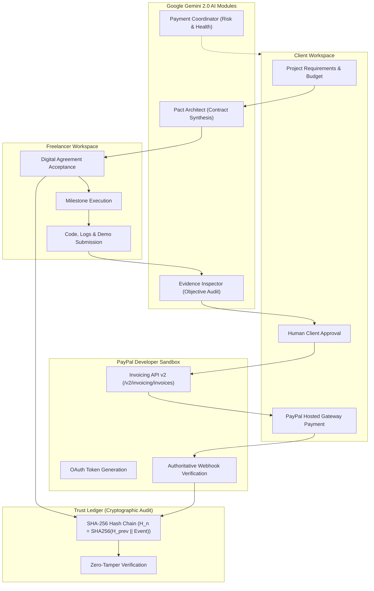

# PACTFLOW
> **Where Work Meets Trust.**

[](https://github.com/pactflow/pactflow/actions)
[](LICENSE)
[](https://www.python.org/downloads/)
[](https://nextjs.org/)
[](https://fastapi.tiangolo.com/)
[](https://developer.paypal.com/)
[](https://ai.google.dev/)

---

## 1. What is PACTFLOW?

**PACTFLOW** is an AI-powered agreement, deliverable verification, and milestone payment coordination platform for freelancers, clients, and digital agencies.

It replaces the fragmented and subjective freelance landscape with an unbroken proof-of-work and payment lifecycle:

$$\text{AGREEMENT} \longrightarrow \text{WORK} \longrightarrow \text{EVIDENCE} \longrightarrow \text{APPROVAL} \longrightarrow \text{PAYPAL SETTLEMENT} \longrightarrow \text{TRUST LEDGER}$$

### The Core Problem
Freelance engagements suffer from subjective scope creep, unverified deliverables, and payment mistrust. Clients worry about incomplete code or fake mockups, while freelancers worry about delayed or disputed payments.

### The PACTFLOW Solution
1. **AI Agreement Synthesis**: Gemini Pact Architect parses requirements into structured milestone contracts with objective acceptance criteria.
2. **Dual-Party Acceptance**: Client and freelancer digitally sign the exact version, recorded in an immutable ledger.
3. **Objective Evidence Auditing**: Gemini Evidence Inspector rigorously audits submitted code, logs, and staging links (never accepting screenshots for dynamic server claims).
4. **Human-in-the-Loop Governance**: AI advises; the human client makes the final approval decision. AI never independently authorizes disbursements.
5. **Real PayPal Sandbox Invoicing v2**: Approved milestones generate authoritative PayPal invoices with hosted payment URLs, verified via cryptographic webhooks.
6. **Cryptographic Trust Ledger**: Every event is chained with SHA-256 hashes ($H_n$), ensuring mathematical tamper-evidence.

---

## 2. Platform Architecture



---

## 3. Critical PayPal Integration

PACTFLOW implements the **real PayPal Developer Sandbox REST API** (`https://api-m.sandbox.paypal.com`):

- **OAuth 2.0 Token Caching (`paypal/oauth.py`)**: Thread-safe client credentials grant with expiration buffering.
- **Invoicing API v2 (`paypal/invoices.py`)**:
  - `POST /v2/invoicing/invoices`: Creates authoritative draft invoices.
  - `POST /v2/invoicing/invoices/{id}/send`: Dispatches invoice and captures hosted payer URL.
  - `GET /v2/invoicing/invoices/{id}`: Authoritatively inspects payment state.
- **Webhook Verification & Idempotency (`paypal/webhooks.py`)**:
  - Calls `POST /v1/notifications/verify-webhook-signature` to cryptographically verify incoming PayPal transmission headers (`PAYPAL-AUTH-ALGO`, `PAYPAL-CERT-URL`, `PAYPAL-TRANSMISSION-SIG`).
  - Strict deduplication ensures retried webhooks do not duplicate ledger records or ledger events.
- **Zero Escrow Misrepresentation**: PACTFLOW does not hold funds. Payments occur directly through PayPal.

---

## 4. Google Gemini AI Modules

1. **Pact Architect (`agents/pact_architect.py`)**:
   - Converts requirements into concrete, falsifiable acceptance criteria.
   - Strictly enforces that the sum of milestone amounts equals the total budget.
   - Sanitizes input against prompt injection attempts.
2. **Evidence Inspector (`agents/evidence_inspector.py`)**:
   - Audits deliverables with honest verdicts: `satisfied`, `uncertain`, `missing`, `unable_to_verify`.
   - Rejects screenshots for dynamic testing or backend verification claims.
   - Provides confidence scores and actionable recommendations.
3. **Payment Coordinator (`agents/payment_coordinator.py`)**:
   - Continuously monitors milestone states, pending invoices, and schedules proactive reminders.

---

## 5. Technology Stack

- **Frontend**: Next.js 14 (App Router), TypeScript, Tailwind CSS, Lucide Icons, Recharts.
- **Backend**: Python 3.12+, FastAPI, Pydantic v2, PyJWT, Cryptography, HTTPX.
- **Database & RLS**: PostgreSQL (Supabase schema migrations, foreign keys, RLS policies).
- **AI**: Google Gemini API (`google-genai` SDK, structured JSON output).
- **Payments**: PayPal Developer Sandbox (REST API, Invoicing v2, Webhooks).
- **Testing**: Pytest, Pytest-Asyncio (17 automated unit, integration, and E2E tests).

---

## 6. Quick Start Guide

### Prerequisites
- Python 3.12+
- Node.js 20+
- npm 10+

### Option A: Local Development

1. **Clone and Configure Environment**:
   ```bash
   cp .env.example .env
   # Add your PayPal Sandbox and Gemini API keys (optional for local mock testing)
   ```

2. **Run Backend Service**:
   ```bash
   cd backend
   pip install -r requirements.txt
   uvicorn app.main:app --host 0.0.0.0 --port 8000 --reload
   ```
   *FastAPI documentation will be live at `http://localhost:8000/docs`*

3. **Run Frontend Application**:
   ```bash
   cd frontend
   npm install
   npm run dev
   ```
   *PACTFLOW application will be live at `http://localhost:3000`*

### Option B: Docker Compose
```bash
docker-compose up --build
```

---

## 7. Running Test Suites

Run the complete 17-test suite covering unit, integration, and end-to-end flows:

```bash
cd backend
python -m pytest tests -v
```

### Verified Test Results:
```
backend/tests/e2e/test_full_workflow.py::test_full_pactflow_end_to_end_workflow PASSED
backend/tests/integration/test_sandbox_payment_lifecycle.py::test_full_sandbox_payment_lifecycle PASSED
backend/tests/unit/test_evidence_inspector.py::test_evidence_inspector_honest_screenshot_limitation PASSED
backend/tests/unit/test_evidence_inspector.py::test_evidence_inspector_satisfied_with_complete_artifacts PASSED
backend/tests/unit/test_pact_architect.py::test_pact_architect_budget_sum_matches PASSED
backend/tests/unit/test_pact_architect.py::test_pact_architect_structured_criteria PASSED
backend/tests/unit/test_paypal_invoices.py::test_paypal_create_invoice_success PASSED
backend/tests/unit/test_paypal_invoices.py::test_paypal_send_invoice_and_hosted_url PASSED
backend/tests/unit/test_paypal_oauth.py::test_paypal_oauth_missing_credentials PASSED
backend/tests/unit/test_paypal_oauth.py::test_paypal_oauth_success_and_caching PASSED
backend/tests/unit/test_paypal_oauth.py::test_paypal_oauth_failure_handling PASSED
backend/tests/unit/test_paypal_webhooks.py::test_webhook_signature_verification_success PASSED
backend/tests/unit/test_paypal_webhooks.py::test_webhook_signature_verification_failure PASSED
backend/tests/unit/test_paypal_webhooks.py::test_webhook_missing_headers PASSED
backend/tests/unit/test_trust_ledger.py::test_trust_ledger_chain_integrity PASSED
backend/tests/unit/test_trust_ledger.py::test_trust_ledger_tamper_detection PASSED
backend/tests/unit/test_trust_ledger.py::test_hash_calculation_determinism PASSED

============================= 17 passed in 4.44s ==============================
```

---

## 8. Hackathon Resources & Documentation

- [Product Requirements Document (PRD)](docs/PRD.md)
- [System Architecture](docs/ARCHITECTURE.md)
- [Database Schema & RLS Policies](docs/DATABASE.md)
- [REST API Reference](docs/API.md)
- [Security & Threat Model](docs/SECURITY.md)
- [Development Tools & Commands](docs/TOOLS.md)
- [3-Minute Demo Pitch Script](docs/DEMO_SCRIPT.md)

---

## 9. License

This project is licensed under the MIT License - see the [LICENSE](LICENSE) file for details.

