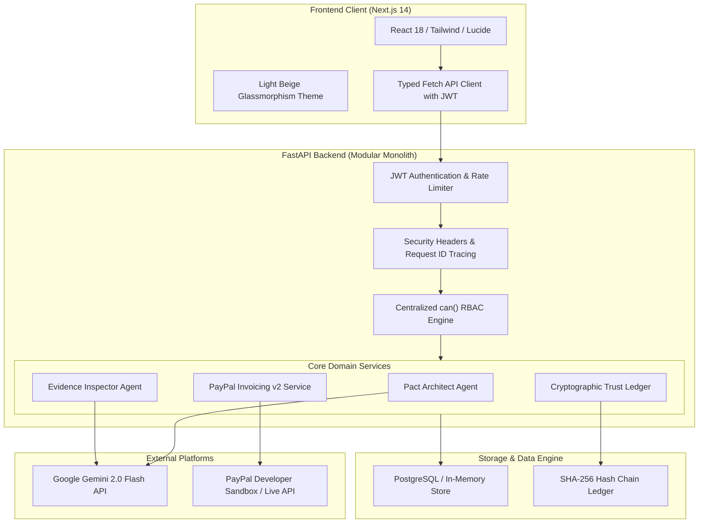

# PACTFLOW: System Architecture

## 1. System Component Diagram



---

## 2. Stack Choices & Trade-Offs

| Layer | Chosen Technology | Alternative Rejected | Rationale |
| :--- | :--- | :--- | :--- |
| **Frontend** | **Next.js 14 (App Router) + TypeScript** | React SPA (Vite) | Next.js App Router provides built-in SSR/SSG, dynamic OpenGraph meta tag injection, file-system routing, and production asset optimization. |
| **Styling** | **Tailwind CSS + Glassmorphism** | Styled Components / MUI | Tailwind delivers zero runtime CSS overhead, responsive breakpoint utilities, and easy maintainability for custom glassmorphic styling tokens. |
| **Backend** | **FastAPI (Python 3.12+)** | Node.js (NestJS / Express) | FastAPI has native Pydantic v2 validation at high throughput, native OpenAPI docs, and seamless integration with the Google GenAI Python SDK. |
| **Database** | **PostgreSQL (Supabase / In-Memory)** | MongoDB / NoSQL | Relational integrity, foreign key cascades, and ACID transactions are non-negotiable for multi-tenant agreements and financial invoicing. |
| **Payments** | **PayPal Invoicing API v2** | Custom Escrow / Stripe | Eliminates custodial banking and money transmission compliance while providing global buyer/seller protection. |
| **AI LLM** | **Google Gemini 2.0 Flash** | OpenAI GPT-4o-mini | Gemini 2.0 Flash offers structured JSON output schema enforcement, high token context windows, low latency, and cost-effective pricing. |

---

## 3. Repository Folder Structure

```
PACTFLOW/
├── .github/
│   └── workflows/
│       └── ci.yml                 # Automated CI: lint, typecheck, tests, build
├── backend/
│   ├── app/
│   │   ├── agents/               # Gemini AI Agents (Pact Architect, Evidence Inspector)
│   │   ├── api/                  # FastAPI routers (auth, projects, agreements, deliverables, etc.)
│   │   ├── database/             # Store layer & seed data
│   │   ├── paypal/               # PayPal OAuth, Invoicing v2 client & webhooks
│   │   ├── schemas/              # Pydantic v2 schemas for request/response contracts
│   │   ├── security/             # Centralized permissions can(), JWT, password hashing
│   │   ├── utils/                # Security validators, hashing, env validator
│   │   ├── config.py             # Strongly typed Pydantic Settings
│   │   └── main.py               # FastAPI entry point, middleware, health endpoints
│   ├── scripts/                  # Operational runbook scripts (backup, load test)
│   ├── tests/                    # Unit, integration, and E2E test suites
│   └── requirements.txt
├── docs/
│   ├── decisions/                # Architecture Decision Records (ADRs)
│   ├── runbooks/                 # Operational runbooks (deploy, rollback, backups, incident)
│   ├── system-design.md
│   ├── architecture.md
│   ├── permissions.md
│   ├── api-conventions.md
│   ├── hosting.md
│   ├── testing.md
│   ├── caching.md
│   ├── monitoring.md
│   └── pre-launch-checklist.md
├── frontend/
│   ├── app/                      # Next.js App Router pages, layouts, and error boundaries
│   ├── components/               # Design system components, Navbar, Footer, Banner
│   ├── public/                   # Static assets, SVG favicons, icons
│   ├── package.json
│   ├── tailwind.config.ts
│   └── tsconfig.json
├── package.json                  # Root convenience scripts (dev, test, lint, build)
├── CLAUDE.md                     # Agent memory file for Claude Code
└── AGENTS.md                     # Agent memory file for Codex / OpenAI
```

---

## 4. Background Jobs Architecture
- **Asynchronous Task Processing**: Webhook processing, AI evidence extraction on large files, and notification dispatch are executed via asynchronous FastAPI background tasks or dedicated workers (e.g. Celery / Redis Queue / Inngest in production).
- **Idempotency Guarantee**: Every background job checks the processed event ledger to prevent re-execution upon retry.
- **Exponential Backoff**: Third-party API calls (PayPal token refresh, Gemini API queries) employ exponential backoff with jitter and max retries of 3.

---

## 5. Third-Party Services & Cost Model

| Service | Purpose | Launch Tier Cost | 10x Scale Cost |
| :--- | :--- | :--- | :--- |
| **Vercel** | Frontend Edge Hosting & CDN | Free / Pro ($20/mo) | Pro ($20/mo + bandwidth) |
| **Railway / Render** | Backend FastAPI Container | Hobby ($5/mo) | Pro ($25 - $50/mo) |
| **Supabase** | PostgreSQL Database & Auth | Free Tier ($0) | Pro ($25/mo) |
| **Google Gemini API** | AI Scope & Evidence Audit | Pay-per-use (~$5/mo) | Pay-per-use (~$60/mo) |
| **PayPal Developer** | Sandbox & Live Invoicing | 0 base cost (Standard transaction fees on payment) | Transaction fees only |
| **Total Monthly Infra** | | **~$30 / month** | **~$150 / month** |

---

## 6. Riskiest Decisions & Mitigations

1. **Third-Party Payment Dependency (PayPal)**:
   - *Risk*: PayPal webhook delays or API outages could stall milestone transitions.
   - *Mitigation*: Fallback manual invoice verification via PayPal Transaction ID lookup; idempotent retry reconciliation worker.
2. **AI Verification Hallucinations & Prompt Injections**:
   - *Risk*: A contractor crafts a malicious prompt inside deliverable notes tricking the AI into issuing an unverified pass.
   - *Mitigation*: Strict prompt injection regex filters, isolated `<UNTRUSTED_DATA>` boundaries, mandatory human-in-the-loop client approval before any invoice issuance.
3. **Escrowless Non-Custodial Adoption**:
   - *Risk*: Clients might prefer traditional deposit-and-hold escrow rather than paying invoices per milestone.
   - *Mitigation*: Highlight 0% escrow deposit lockup, zero custodial fees, and full transparency backed by cryptographic Trust Ledger proofs.
